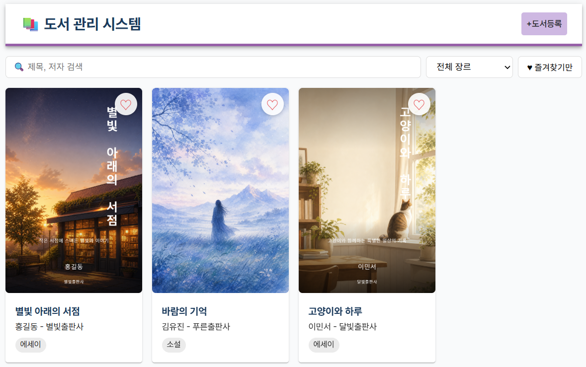
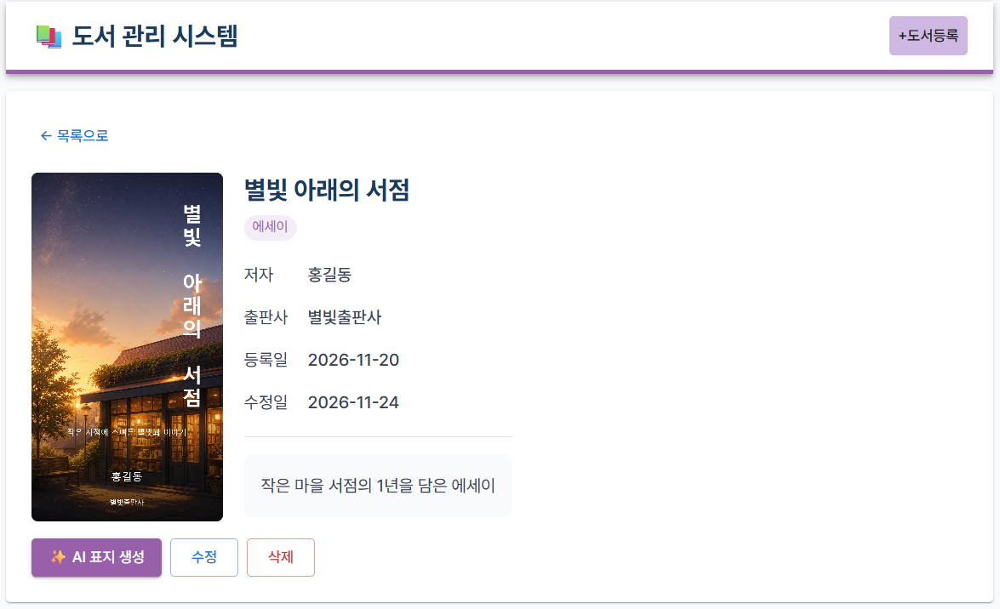
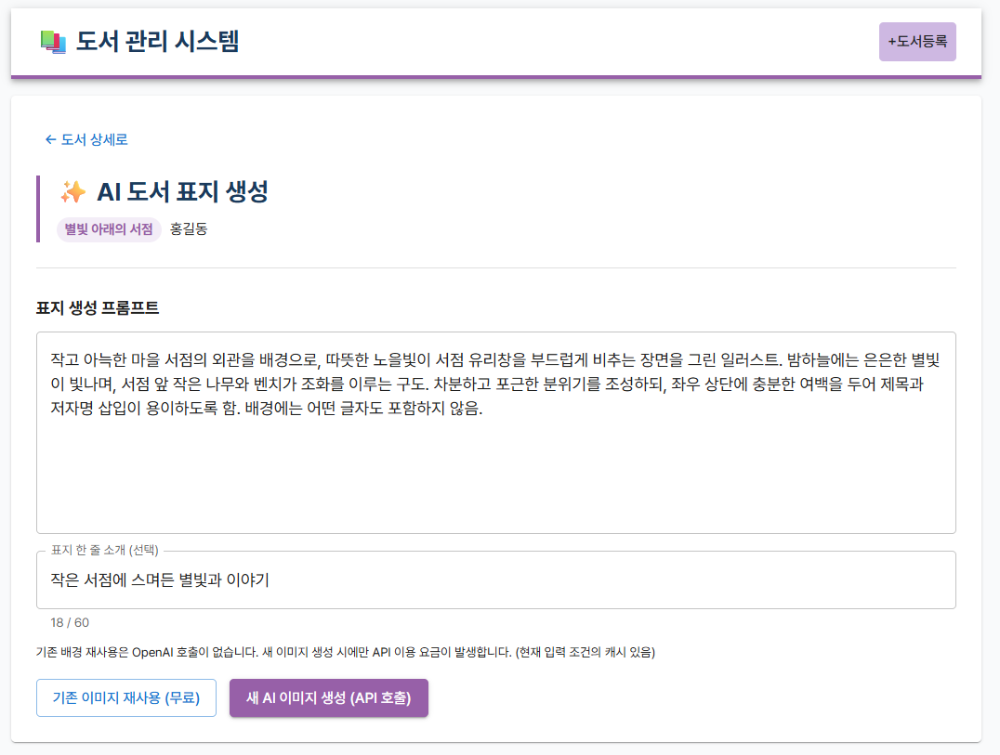
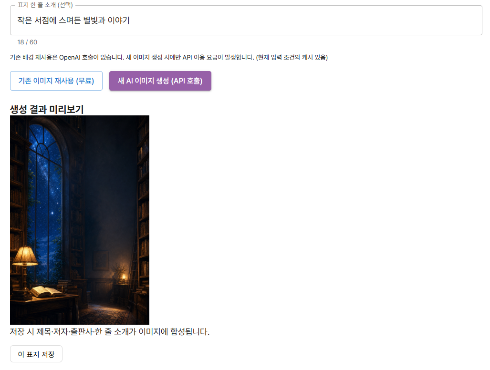
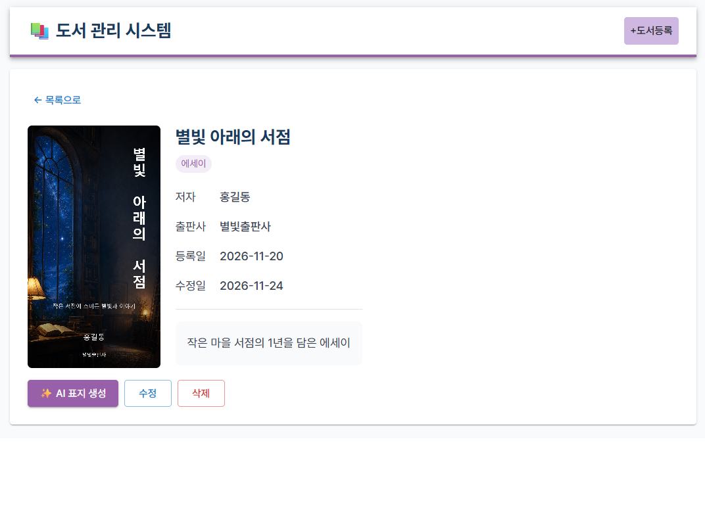

# 📚 AI 도서 표지 생성 및 도서 관리 시스템

## 1. 프로젝트 소개

본 프로젝트는 **KT AIVLE School 2반 7조의 4차 미니프로젝트**로, 도서 관리 기능과 AI 표지 이미지 생성 기능을 결합한 웹 서비스입니다.

사용자는 도서를 등록·조회·수정·삭제할 수 있으며, OpenAI API를 활용하여 책의 내용과 분위기에 어울리는 표지 이미지를 생성할 수 있습니다.

생성된 배경 이미지에는 도서 제목, 저자, 출판사 및 한 줄 소개를 Canvas API로 합성하여 최종 표지로 저장합니다.

## 2. 주요 기능

### 2-1. 도서 관리
- 도서 등록·조회·수정·삭제 (CRUD)
- 제목 및 저자 검색
- 장르별 필터링
- 즐겨찾기 등록 및 즐겨찾기 도서만 보기
- 도서 카드 마우스 오버 시 내용 미리보기
- 필수 입력값 및 글자 수 유효성 검사

### 2-2. AI 표지 생성
- 도서 정보를 기반으로 표지 생성 프롬프트 추천
- 프롬프트 직접 입력 및 수정
- 표지 한 줄 소개 입력 및 AI 추천
- OpenAI API를 이용한 배경 이미지 생성
- 생성 결과 미리보기
- 동일 입력 조건의 캐시 이미지 재사용
- Canvas API로 제목·저자·출판사·소개 문구 합성
- 최종 표지 저장 및 도서 화면 반영

※ 새로운 AI 이미지 생성 시 API 이용 요금이 발생할 수 있습니다.

## 3. 주요 화면

### 3-1. 도서 목록

도서 목록을 확인하고 제목·저자 검색, 장르 필터링, 즐겨찾기 기능을 이용할 수 있습니다.



### 3-2. 도서 상세

도서의 표지 및 상세 정보를 확인하고 수정, 삭제, AI 표지 생성 기능으로 이동할 수 있습니다.



### 3-3. AI 표지 생성

도서 정보를 기반으로 추천된 프롬프트와 한 줄 소개를 확인하거나 직접 수정할 수 있습니다.



### 3-4. AI 이미지 생성 결과 미리보기

생성된 배경 이미지를 미리 확인하고 원하는 결과를 선택하여 저장할 수 있습니다.



### 3-5. 최종 표지 저장 결과

생성된 배경 이미지에 도서 제목, 저자, 출판사, 한 줄 소개를 합성하여 최종 표지를 저장합니다.



## 4. 기술 스택

| 구분 | 사용 기술 |
| --- | --- |
| Frontend | React 19, Vite |
| UI | Material UI (MUI), CSS |
| 도서 데이터 서버 | json-server 0.17.4 |
| AI API 서버 | Node.js, Express |
| AI | OpenAI API |
| 이미지 처리 | HTML Canvas API |
| API 통신 | Fetch API |
| 협업 및 버전 관리 | Git, GitHub |

## 5. 프로젝트 실행 방법

Node.js와 Git이 설치된 환경에서 실행합니다.

### 5-1. 저장소 다운로드 및 의존성 설치

```bash
git clone https://github.com/obgybbl77/-4-.git
cd ./-4-
npm install
```

이미 저장소를 다운로드한 경우 프로젝트 폴더에서 `npm install`을 실행합니다.

### 5-2. OpenAI API Key 설정

프로젝트 최상위 폴더에 `.env` 파일을 생성하고 OpenAI API Key를 입력합니다.

```env
OPENAI_API_KEY=YOUR_OPENAI_API_KEY
```

현재 AI 서버는 서버 환경변수에서 API Key를 읽습니다.

**보안 주의사항**
- `.env` 파일은 GitHub에 업로드하지 않습니다.
- `.gitignore`에 `.env` 파일이 등록되어 있습니다.

### 5-3. 도서 데이터 서버 실행 (터미널 1)

```bash
npx json-server@0.17.4 --watch db.json
```

실행 주소: http://localhost:3000/books

### 5-4. AI API 서버 실행 (터미널 2)

```bash
node server/index.mjs
```

실행 주소: http://localhost:3001

### 5-5. React 개발 서버 실행 (터미널 3)

```bash
npm run dev
```

실행 주소: http://localhost:5173/

세 서버를 모두 실행한 상태에서 웹페이지에 접속합니다.

### 5-6. Windows PowerShell 실행 오류 발생 시

PowerShell에서 npm 또는 npx 실행이 차단되는 경우 다음 명령어를 사용할 수 있습니다.

```powershell
npm.cmd install
npx.cmd json-server@0.17.4 --watch db.json
npm.cmd run dev
```

AI 서버는 별도 터미널에서 `node server/index.mjs`로 실행합니다.

## 6. AI 표지 생성 사용 방법

1. 도서 목록에서 표지를 생성할 도서를 선택합니다.
2. 도서 상세 화면에서 **AI 표지 생성** 버튼을 클릭합니다.
3. 추천된 프롬프트와 한 줄 소개를 확인하고 필요하면 수정합니다.
4. **새 AI 이미지 생성** 버튼을 클릭하여 배경 이미지를 생성합니다.
5. 생성된 이미지를 미리 확인합니다.
6. **이 표지 저장** 버튼을 클릭하면 도서 정보가 이미지에 합성되어 저장됩니다.
7. 도서 상세 및 목록 화면에서 저장된 표지를 확인할 수 있습니다.

### 이미지 재사용 안내

- 현재 구현에서는 같은 도서 정보와 프롬프트 조건의 이미지를 브라우저 메모리에 캐시합니다.
- 해당 조건의 캐시가 존재하면 추가 OpenAI 이미지 생성 호출 없이 재사용할 수 있습니다.
- 캐시는 최대 3개까지 보관하며, 브라우저 새로고침 시 유지되지 않습니다.
- 새 이미지를 생성하면 OpenAI API 이용 요금이 발생할 수 있습니다.

## 7. 프로젝트 구조

```text
프로젝트/
├── docs/
│   └── images/                 # README 주요 화면
├── public/                     # 정적 리소스
├── server/
│   └── index.mjs               # AI API 서버
├── src/
│   ├── assets/
│   ├── components/
│   │   ├── BookCard.jsx
│   │   ├── BookDetail.jsx
│   │   ├── BookForm.jsx
│   │   ├── BookList.jsx
│   │   ├── CoverGenerator.jsx
│   │   └── Header.jsx
│   ├── utils/
│   │   ├── composeBookCover.js
│   │   └── coverStyle.js
│   ├── App.jsx
│   ├── App.css
│   ├── index.css
│   └── main.jsx
├── db.json                     # 도서 데이터
├── package.json
├── vite.config.js
├── .gitignore
└── README.md
```

`.env` 파일은 각 개발자가 로컬 환경에 별도로 생성합니다.

## 8. 팀 구성 및 역할

| 이름 | 담당 업무 | 팀 내 역할 |
| --- | --- | --- |
| 정수아 | OpenAI 연동 | 조장 |
| 손요한 | PM 및 기획 | 검토 담당자 |
| 김태규 | CRUD 연동 | 서기 |
| 이진석 | 스타일링 및 QA | PPT 제작자 |
| 손희주 | UI 및 레이아웃 | PPT 제작자 |
| 김다연 | 발표 및 문서 | 발표자 |

## 9. Git 협업 방식

- `main`: 팀 공용 브랜치
- `feat/기능명`: 기능 개발 브랜치
- `docs/기능명`: 문서 작업 브랜치
- 각자 작업 브랜치에서 수정 후 Push합니다.
- Pull Request를 통해 변경사항을 검토하고 병합합니다.

※ API Key 및 기타 민감한 정보는 GitHub에 커밋하지 않습니다.

## 10. 개발 진행 현황

### 구현된 기능
- [x] 프로젝트 초기 기획 및 설계
- [x] React 및 Vite 프로젝트 구성
- [x] json-server 기반 도서 CRUD 연동 코드
- [x] 제목·저자 검색 및 장르 필터링
- [x] 도서 즐겨찾기 기능
- [x] 입력값 유효성 검사
- [x] 도서 카드 뒤집기 UI
- [x] OpenAI API 연동 코드
- [x] AI 표지 이미지 생성 및 미리보기
- [x] 동일 입력 조건의 이미지 캐시 재사용 기능
- [x] Canvas 기반 최종 표지 합성 및 저장
- [x] MUI 기반 UI 구현

### 최종 검토 및 보완 사항
- [ ] CRUD 전체 통합 테스트 및 QA 검증
- [ ] AI 표지 생성·저장·재조회 최종 검증
- [ ] API Key 입력 UI 추가 및 연동 검토
- [ ] 이미지 생성 옵션 선택 UI 검토
- [ ] 기존 이미지 재사용 버튼 동작 검증
- [ ] 도서 정보 수정 시 기존 표지 텍스트 동기화 검토
- [ ] 긴 제목 및 표지 텍스트 디자인 검토
- [ ] 전체 UI/UX 최종 검토
- [ ] 최종 발표 자료 및 제출 산출물 점검

※ 위 항목은 현재 확인된 코드와 작업 계획을 기준으로 정리했으며, 최종 QA 결과에 따라 변경될 수 있습니다.

